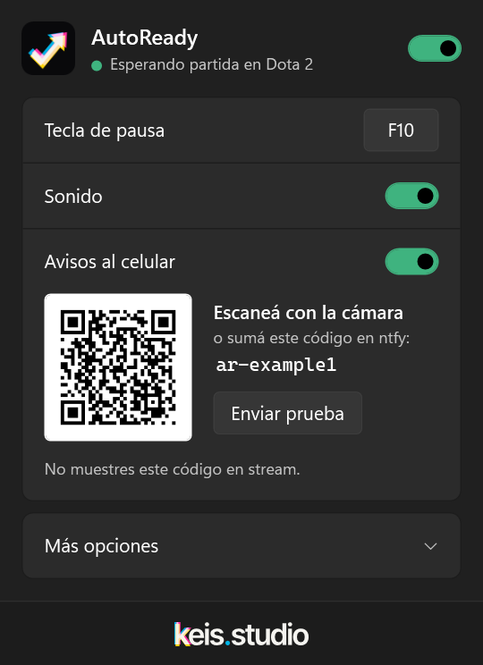

  

<h1 align="center">AutoReady</h1>

  <b>Buscá partida, andá a hacer otra cosa. AutoReady la acepta por vos.</b> 
  Una app gratis para Windows que acepta tus partidas de Steam y te avisa cuándo volver. 
  Funciona con Dota 2 y Counter-Strike 2.

  

  
  
  
  
   
  <a href="https://hercase.github.io/autoready/">Sitio web</a> · <a href="README.md">Read in English</a>

<table>
  <tr>
    <td valign="top">
      <h3>Cómo funciona</h3>
      <ol>
        <li><b>Buscá partida</b> en tu juego.</li>
        <li><b>Andá a hacer otra cosa.</b> AutoReady vigila el juego.</li>
        <li>Cuando aparece la partida, <b>toca Aceptar</b> y te avisa con un sonido, una notificación de Windows y, si querés, en el celular.</li>
      </ol>
      <h3>Por qué es seguro</h3>
      <ul>
        <li><b>Nunca hace click durante una partida.</b> Tu estado de Steam y la integración oficial de Valve (Game State Integration) le dicen cuándo estás jugando.</li>
        <li><b>No toca el juego.</b> No lee memoria, no inyecta nada y no modifica archivos del juego.</li>
        <li><b>Sin cuentas, publicidad ni telemetría.</b> Es de código abierto y solo se conecta a internet para lo que dice la <a href="PRIVACY.md">política de privacidad</a>.</li>
      </ul>
    </td>
    <td width="290" align="center" valign="top">
      
    </td>
  </tr>
</table>

## Empezar

1. **[Descargá `AutoReady.exe`](https://github.com/hercase/autoready/releases/latest/download/AutoReady.exe)** y abrilo.
2. Tocá **Instalar**. Se instala para tu usuario en unos segundos, sin permisos de administrador.
3. El ícono aparece junto al reloj (puede estar escondido en **^**: arrastralo afuera para tenerlo a mano).
4. Buscá partida en tu juego y andá a hacer otra cosa.

> [!NOTE]
> Windows puede mostrar un aviso de SmartScreen la primera vez, porque AutoReady todavía no está firmado
> ([en trámite](#code-signing-policy-política-de-firma-de-código)). Tocá **Más información → Ejecutar de todas formas**.

## Cómo se usa

Tocá el ícono para abrir el panel:

- **El interruptor de arriba** activa o pausa AutoReady. El estado de al lado dice qué está haciendo.
- **Tecla de pausa:** elegí una tecla (F1–F12 o una combinación) para pausar y reanudar desde cualquier lado, también jugando.
- **Avisos al celular:** escaneá el código con la cámara del celular e instalá la app gratis [ntfy](https://ntfy.sh).
- **Más opciones:** iniciar con Windows, actualizaciones automáticas y la versión instalada.

Con click derecho en el ícono tenés **Pausar/Reanudar** y **Salir**. El ícono se pone gris cuando está en pausa.
AutoReady se actualiza solo, y está en español o en inglés según el idioma de tu Windows.

## Juegos compatibles

| Juego | Configuración |
|---|---|
| **Dota 2** | Nada. Si hace falta un paso (una sola vez), el panel muestra **Configurar**: copia la opción de lanzamiento y abre las propiedades de Dota en Steam para que solo la pegues. |
| **Counter-Strike 2** | Nada. Reiniciá CS2 una vez después de instalar AutoReady. |

¿Jugás a otra cosa? **[Pedí tu juego](https://github.com/hercase/autoready/issues/new?template=game-request.yml)**: es un minuto, y una captura del aviso de partida encontrada ayuda mucho.

## Preguntas frecuentes

<b>¿Me pueden banear?</b>

 
AutoReady solo mira la ventana del juego y toca Aceptar, como lo harías vos. No lee ni cambia la memoria del juego, no
inyecta nada y no modifica sus archivos. El único archivo que agrega es la configuración oficial de Game State
Integration de Valve, que existe para herramientas de terceros. Los términos de Steam mencionan el software de
automatización, así que el riesgo no es cero, pero nada de esto toca la partida en sí.

<b>¿Hace click en algo durante la partida?</b>

 
No. Cuando empieza la partida deja de mirar hasta que volvés al menú. Si no puede saber si estás en partida, funciona en
modo seguro: solo hace click, y nunca mientras estás usando el mouse o el teclado en el juego.

<b>¿Lo puedo usar para quedarme AFK?</b>

 
No, y te pedimos que no lo hagas. Está para que no pierdas una partida mientras buscás algo. Aceptá y volvé: irte
perjudica a los otros nueve jugadores.

<b>No aceptó mi partida. ¿Qué hago?</b>

 
Fijate que el interruptor de arriba del panel esté activado y que no aparezca el aviso <b>Configurar</b>. Si igual
falla, <a href="https://github.com/hercase/autoready/issues/new">abrí un issue</a> con tu juego, la resolución de
pantalla y la escala de Windows.

<b>¿Funciona con dos monitores?</b>

 
Debería, esté donde esté el juego. Todavía lo estamos probando con varios monitores, así que si algo no anda,
<a href="https://github.com/hercase/autoready/issues/6">avisanos</a>.

<b>¿Guarda capturas de pantalla?</b>

 
Durante la beta sí, para mejorar la detección: cuando acepta una partida, y cuando empieza una partida que no aceptó.
Solo la ventana del juego, solo en tu PC (<code>%APPDATA%\AutoReady\samples</code>), y solo las últimas 15. No se sube
nada. Se apagan con <code>SaveSamples=False</code> en <code>%APPDATA%\AutoReady\autoready.ini</code>.

<b>¿Cómo lo desinstalo?</b>

 
<b>Configuración → Aplicaciones → Aplicaciones instaladas → AutoReady → Desinstalar.</b> Borra la app, sus accesos
directos y los archivos de Game State Integration, y te pregunta si querés borrar también tu configuración.

## Code signing policy (política de firma de código)

Free code signing provided by [SignPath.io](https://about.signpath.io), certificate by [SignPath Foundation](https://signpath.org).
(Firma de código gratuita de SignPath.io, certificado de SignPath Foundation. La solicitud está en curso: hasta que
la aprueben, las versiones todavía no están firmadas.)

- Autores y revisores: [hercase](https://github.com/hercase)
- Aprobadores: [hercase](https://github.com/hercase)

Cada versión se compila desde este repositorio con GitHub Actions, se escanea con Microsoft Defender y se firma solo
después de una aprobación manual.

**Privacidad:** AutoReady no tiene cuentas, estadísticas ni telemetría. Solo se conecta a GitHub (actualizaciones), a
la Comunidad de Steam (tu propio estado) y a ntfy (avisos al celular, apagado por defecto), y cada una se puede
apagar. Ver la [política de privacidad](PRIVACY.md).

## Estado

AutoReady está en **beta** (versiones 0.x). Lo que viene y los problemas conocidos están en
[Issues](https://github.com/hercase/autoready/issues). ¿Querés compilarlo o ayudar? Empezá por
[CONTRIBUTING.md](CONTRIBUTING.md).

 

  <a href="https://keis.studio">
    <picture>
      <source media="(prefers-color-scheme: dark)" srcset="assets/keis-wordmark-dark-tight.svg">
      
    </picture>
  </a>
   
  <a href="LICENSE">Licencia MIT</a>

