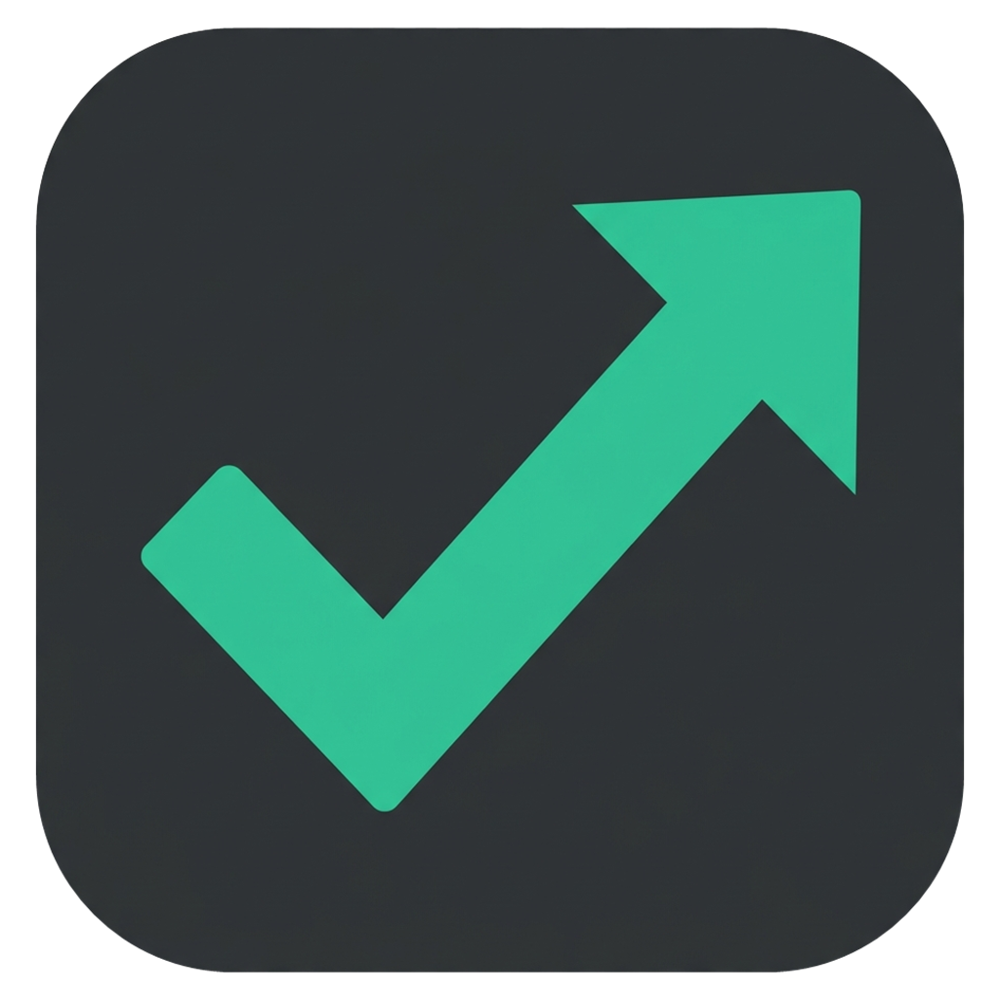

<p align="center"></p>

# ReadyUp

**Buscá partida, andá a hacer otra cosa. ReadyUp la acepta por vos.**

Un auto-accept chiquito para **Dota 2** y **Counter-Strike 2** en Windows. Apretás *Buscar partida*, te vas a buscar algo de tomar y ReadyUp hace click en **ACEPTAR** cuando aparece la partida. Después te avisa al celular para que vuelvas a tiempo para el pick.

[English](README.md)

## Qué hace

- ✅ Detecta el botón verde **ACEPTAR** y le hace click, aunque Dota esté tapado por otra ventana o minimizado.
- 🛡️ Usa **Game State Integration**, la integración oficial de Valve, para saber cuándo estás en partida, y ahí deja de escanear. Nunca hace clicks dentro del juego.
- 📱 Si querés, te manda avisos al celular con [ntfy](https://ntfy.sh) (gratis, sin cuenta): *"¡Partida aceptada!"* y *"¡Empezó el pick, volvé!"*.
- 🪶 Pesa unos 30 KB, es un solo `.exe`, no se instala y no necesita descargar nada más. Vive en la bandeja del sistema.
- 🔍 Es 100% código abierto y se compila con el compilador de C# que ya trae Windows.

## ¿Es seguro? ¿Me pueden banear?

ReadyUp **solo mira la pantalla y simula un click**, como haría una persona. No inyecta código, no lee la memoria del juego y no modifica archivos de Dota. Lo único que escribe es la config oficial de GSI, en `dota/cfg/gamestate_integration` y en `csgo/cfg`.

No lo uses para quedarte AFK mucho tiempo: aceptá la partida y volvé. Abandonar perjudica a los otros 9 jugadores y te manda a low priority.

## Instalación

1. Bajá `ReadyUp.exe` de [Releases](../../releases) (o compilalo vos, ver más abajo) y abrilo.
2. **Dota 2:** en Steam, **Dota 2 → Propiedades → Opciones de lanzamiento**, agregá `-gamestateintegration` y reiniciá Dota.
   **CS2:** no hay que hacer nada, solo reiniciá CS2 una vez para que cargue la config de GSI.
3. Elegí qué juegos vigilar en el menú del ícono → **Juegos**.
4. Opcional: click derecho en el ícono → **Conectar celular...** y seguí los pasos.

Windows SmartScreen puede mostrar una advertencia porque el exe no está firmado. Tocá **Más información → Ejecutar de todas formas**, o compilalo desde el código.

## Ícono en la bandeja

| Ícono | Significado |
|---|---|
| 🟢 | Armado: esperando partida (o en partida, sin escanear) |
| ⚪ | En pausa (doble click en el ícono para cambiar) |
| 🟡 | Dota no está abierto |

Menú con click derecho: pausar, **Juegos** (cuáles vigilar), **Avisos** (sonido, celular, arranque de partida) y **Opciones** (iniciar con Windows, actualizaciones). Con **Shift** + click derecho aparece **Diagnóstico**.

## Compilar

```bat
build.bat
```

Genera `dist\ReadyUp.exe`. Solo necesitás Windows 10/11 (usa el `csc.exe` de .NET Framework 4, que ya viene instalado).

## Problemas

- **No detecta el botón:** con el popup en pantalla, Shift + click derecho → *Diagnóstico* → *Guardar captura*. La imagen muestra el área de búsqueda (en celeste) y el botón detectado (en rojo). Los valores de detección están en `%APPDATA%\ReadyUp\readyup.ini`.
- **Probar el detector con una imagen:** `ReadyUp.exe --test captura.png dota2` (o `cs2`) genera `captura.result.png` y `.result.txt`.
- **Logs:** `%APPDATA%\ReadyUp\readyup.log`.

## Licencia

MIT

---

<p align="center">
  <a href="https://keis.studio">
    <picture>
      <source media="(prefers-color-scheme: dark)" srcset="assets/keis-wordmark-dark.svg">
      
    </picture>
  </a>
  <br>
  <sub>Hecho por <a href="https://keis.studio">keis.studio</a></sub>
</p>
