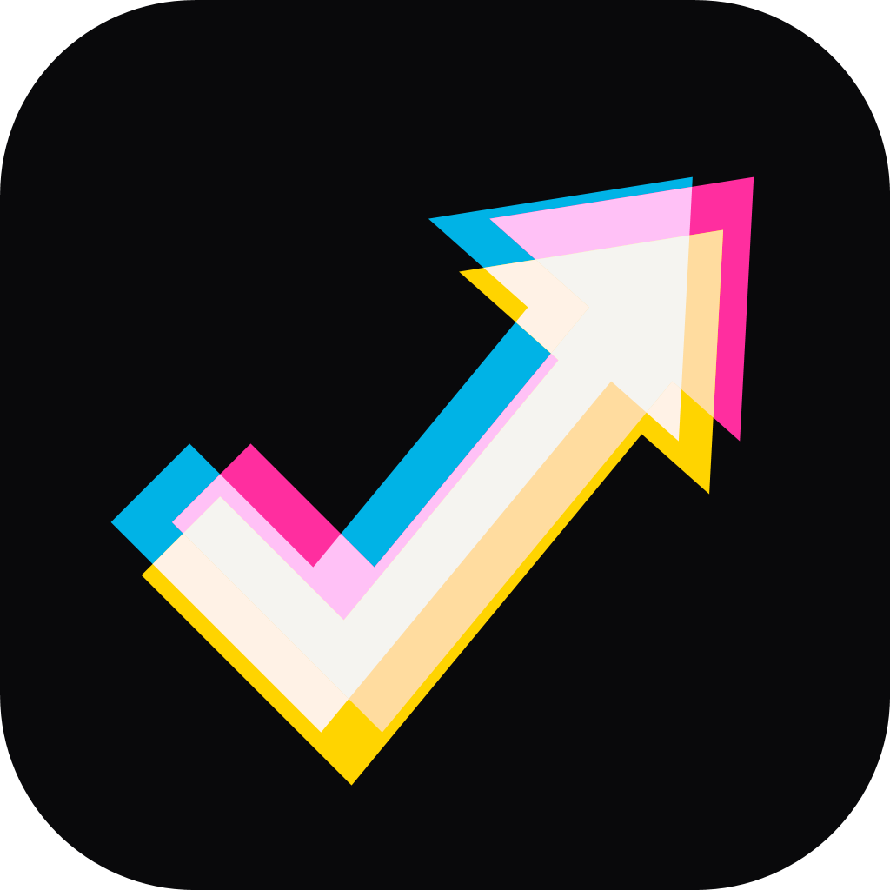
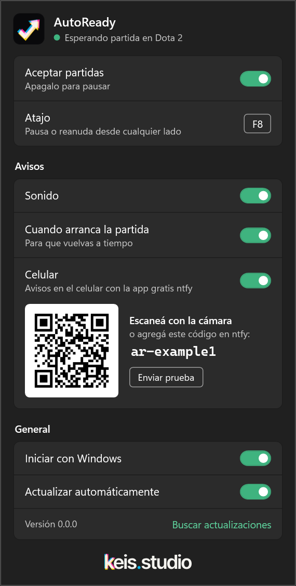

  

<h1 align="center">AutoReady</h1>

  <b>Queue up. Step away. AutoReady accepts the match for you.</b> 
  Auto-accept for Dota 2 and Counter-Strike 2 on Windows.

  

  
  
  
  
   
  <a href="README.es.md">Leer en español</a>

## How it works

<table>
  <tr>
    <td align="center" width="33%">🎮 <b>Queue up</b> Hit <i>Find match</i> in Dota 2 or CS2.</td>
    <td align="center" width="33%">☕ <b>Step away</b> Grab a drink. AutoReady keeps an eye on the game.</td>
    <td align="center" width="33%">✅ <b>Come back in time</b> It clicks <i>Accept</i> and lets you know.</td>
  </tr>
</table>

## Features

<table>
  <tr>
    <td valign="top">
      <ul>
        <li><b>Accepts the match</b> even if the game is behind other windows or minimized.</li>
        <li><b>Never clicks during a match.</b> Valve's official Game State Integration tells it when you're in game.</li>
        <li><b>Lets you know</b> with a sound, a Windows notification and, if you want, your phone.</li>
        <li><b>Pause it from anywhere</b> with a hotkey you choose, even while playing.</li>
        <li><b>One small file.</b> No install, no extra downloads, and it updates itself.</li>
      </ul>
    </td>
    <td width="280" align="center">
      
    </td>
  </tr>
</table>

## Supported games

| Game | Setup |
|---|---|
| **Dota 2** | Add `-gamestateintegration` to the launch options (Steam → Dota 2 → Properties). |
| **Counter-Strike 2** | Nothing to do. Restart CS2 once after opening AutoReady. |

Want another game? [Ask for it](https://github.com/hercase/autoready/issues).

## Get started

1. [Download `AutoReady.exe`](https://github.com/hercase/autoready/releases) and open it.
2. The AutoReady icon shows up next to the clock and the panel opens. It's already running.
3. Queue up in your game and step away.

Click the icon any time to open the panel: turn accepting on or off, pick a pause hotkey, and choose how you want to be
notified. Right-click it for **Pause/Resume** and **Exit**. The icon turns gray while paused.

> [!NOTE]
> Windows may show a SmartScreen warning because AutoReady isn't code-signed yet. Click **More info → Run anyway**.

## FAQ

<b>Can I get banned for this?</b>

 
AutoReady only looks at the screen and clicks the Accept button, like you would. It doesn't read or change game memory,
doesn't inject anything and doesn't modify game files. The only file it writes is Valve's official Game State Integration
config.

<b>Does it click anything during a match?</b>

 
No. Game State Integration tells it when you're in a match, and it stops looking until the match is over.

<b>Can I use it to stay AFK?</b>

 
No, and please don't. It's there so you don't miss a match while you grab something. Accept, then come back: leaving hurts
the other nine players.

<b>Does it work with two monitors?</b>

 
It should, wherever the game is. Multi-monitor setups are still being tested, so if something's off,
<a href="https://github.com/hercase/autoready/issues/6">let us know</a>.

<b>It didn't accept my match. What now?</b>

 
Check that <b>Accept matches</b> is on in the panel and, for Dota 2, that <code>-gamestateintegration</code> is in the
launch options. If it still fails, <a href="https://github.com/hercase/autoready/issues">open an issue</a> with your game,
screen resolution and Windows display scale.

## Status

AutoReady is in **beta** (versions 0.x). See what's coming and known issues in
[Issues](https://github.com/hercase/autoready/issues). Want to build it or help out? Start with
[CONTRIBUTING.md](CONTRIBUTING.md).

 

  <a href="https://keis.studio">
    <picture>
      <source media="(prefers-color-scheme: dark)" srcset="assets/keis-wordmark-dark-tight.svg">
      
    </picture>
  </a>
   
  <a href="LICENSE">MIT License</a>

